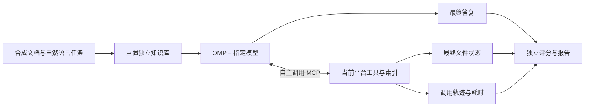

# 通用 Agent 任务 Benchmark

衡量 Agent 能否通过 Folder KB 完成真实任务，以及不同工具、索引配置对结果的影响。
与 `tools/benchmark_*_tools.py` 的接口微基准分开使用：这里不预先编排 Agent 的调用步骤。

## 基本流程



- **任务层**：只说要达成什么结果，不指定 grep、Search、事务等工具或步骤。
- **执行层**：真正运行 `omp`，使用平台动态发现的 MCP 工具及原有工具描述。禁用本地文件、Shell、网络搜索等旁路工具；不载入用户既有会话、技能、扩展和其他 MCP。
- **评分层**：Agent 看不到标准答案。会话结束后检查事实、引用和文件快照；不因为接口返回成功或 Agent 说“完成”就判成功。
- **隔离层**：临时启动随机本地端口的独立平台。每个任务、配置和重复次数均新建库和 Key；运行后撤销 Key、清理测试服务及测试库。不会连接日常运行的平台或私人知识库。

当前以 Windows + OMP 18.2.5 验证。依赖平台测试环境（`pip install -e ".[test]"`）、已配置模型的 OMP，以及平台所需的 `rg`。命令从仓库根目录执行。

## 使用

```powershell
# 先验证接入，执行一个检索任务和一个嵌套写入任务
python -m benchmarks.agent.runner --output data/agent-smoke --tasks R01 W01 --variants hybrid --fail-fast

# 12 个任务 × 3 种配置；每次必须使用新目录
python -m benchmarks.agent.runner --output data/agent-baseline --timeout 120

# 稳定性对比：每个任务、配置独立重复 3 次
python -m benchmarks.agent.runner --output data/agent-repeat3 --repeats 3 --timeout 120

# 根据实际结果生成报告
python -m benchmarks.agent.report data/agent-baseline
```

默认模型为本机已配置的 `hyper-op/GLM-5.3-Flash`。
`--model`、`--omp`、`--models-config` 可替换，不把密钥写入命令行或提交到仓库。
OMP 从已有 `~/.omp/agent/models.yml` 复制模型配置到临时运行配置；不会修改原配置。
生成的运行目录含原始轨迹，应保持在 Git 忽略的 `data/` 内，不要整体上传。

已完成的首轮结果见[精简报告](../../docs/reports/2026-10-04-agent-task-benchmark.md)。

公开基准接入见 [BrowseComp-Plus](../browsecomp/README.md)：支持官方数据下载、独立知识文件夹与任务 CSV、三种 MCP 配置对比、证据召回、离线语义判分和官方 run 格式导出。当前为缩小语料的内部适配版，与此处的合成读写回归分开统计。

`--fail-fast` 只在无模型响应/无 MCP 目录的接入异常时中止，普通任务失败仍继续。
每次任务预算默认 180 秒，可通过 `--timeout` 调整；超时会被计为任务失败。
进程外另设 20 秒收尾上限，防止 OMP 卡住。

## 配置对照

| 配置 | 文件浏览与读取 | grep | Search | 写入 |
|---|---|---|---|---|
| grep | 有 | 有 | 无 | 除权限拒绝任务外允许直接写入 |
| search | 有 | 无 | 有 | 同上 |
| hybrid | 有 | 有 | 有 | 同上 |

三组保持模型、语料、任务、预算及通用系统提示一致。按任务轮换配置顺序，减少固定先后顺序的影响；不强迫 Agent 使用某个工具。
所有库预先绑定相同索引插件并构建索引，仅 Key 的检索权限不同，避免“是否绑定插件”成为额外差异。
插件中的使用说明统一为中性指引，不偏向指定检索工具。

默认索引是示例 `simple-rag` 的 **Markdown 章节切分 + SQLite FTS5 / BM25**。
它是全文检索，不是 Embedding 向量检索；Search 组仍可以浏览目录、读取原文来补充证据。

可用以下参数测试其他符合现有平台插件协议的检索插件定义/程序包（需兼容原生文档库直接写入，不含更新程序）：

```powershell
python -m benchmarks.agent.runner --output data/other-index --variants search hybrid `
  --plugin-definition path/to/definition.json --plugin-source path/to/package
```

平台本身必须支持该插件声明的能力。若需要比较新的向量后端，先实现平台后端/插件，再用同一任务集评测；本 Benchmark 不伪造未实现的检索引擎。

## 任务与验收

| 编号 | 自然语言任务类型 | 独立验收 |
|---|---|---|
| R01 | 查当前发布编号 | 当前值正确，有来源 |
| R02 | 汇总负责人、窗口、备份及阈值 | 跨文档各字段正确 |
| R03 | 核实同事引用的旧安排 | 识别已废止版本，给出当前事实 |
| R04 | 换一种说法询问制度 | 身份凭证对应访问密钥制度 |
| R05 | 查资料没有的个人奖金 | 明确无法确定，不猜金额 |
| R06 | 查上传组件容量上限 | 经服务目录关联限制记录 |
| W01 | 写入深层目录中的长期记忆 | 新文件存在，内容符合，无关资料不变 |
| W02 | 只改连接超时 | 精确修改，其他内容保持 |
| W03 | 先查事实，再更新三个文件 | 编号与状态正确，负责人不变 |
| W04 | 选择性清理临时文件 | 目标删除，正式文件完整 |
| W05 | 整理交接记录到新目录 | 原位置消失，新位置内容完整 |
| W06 | 用只读 Key 请求修改 | 明确拒绝，无文件变化 |

测试数据独立放在 [`../datasets/basic/`](../datasets/basic/README.md)：

```text
benchmarks/
├── agent/                     # 执行、数据加载、评分和报告代码
└── datasets/basic/
    ├── knowledge/             # 24 篇真实 Markdown 文件组成的初始测试库
    ├── tasks.csv              # 12 个任务：id、kind、prompt、write_policy
    └── expectations.json      # 独立验收规则，按任务编号关联
```

`tasks.py` 仅负责读取和校验文件，不再内嵌知识正文和任务定义。可直接修改知识文件，用 Excel 编辑 CSV，新增任务时补充同编号验收规则。仅 `knowledge/` 被复制到每次任务的测试库；任务表与标准答案不挂载，测试修改也不回写源文件。

复制一份数据目录即可建立其他测试集，通过 `--dataset benchmarks/datasets/my-suite` 选择。重评分也支持 `--dataset`，应指向原测试集。详见[数据维护说明](../datasets/basic/README.md)。

读任务要求结构化事实字段以便确定性判分，但不规定工具和路径查找策略；引用必须指向正确资料。
写入校验是文件内容/差异，不依赖用了几次调用或某个工具。禁止无关文件变化。
自动评分覆盖指定事实，不保证已验证答复所有附加解释；完整回答的幻觉评估需要另加人工审查或独立判分。

## 指标及产物

| 指标 | 含义 |
|---|---|
| 目标达成 / 严格通过率 | 事实与文件满足验收；另报含 JSON 状态一致性的严格结果，同时报告接入异常数 |
| Agent 工具调用成功率 | 成功工具结果 / Agent 发起调用，含未到服务端的工具名及参数错误 |
| 服务端工具成功率 | MCP 非错误结果 / 实际到达平台的调用 |
| 恢复能力 | 出错后仍完成任务；同时保留重复相同错误次数 |
| 虚报与副作用 | 声称完成但事实/文件不符；不应变化的文件被修改 |
| 耗时 | 任务端到端、模型累计时间、服务端每次调用、写调用及多文件任务耗时 |
| 调用效率 | 工具分布、调用次数、实际发布事务数、模型报告的 tokens |

接口错误不等于被误导：先探测不存在的文件可能是合理行为。需要结合轨迹确认是正常探索、描述歧义、工具不可发现、参数误用，还是模型误判。
不以“没报错”替代完成率，也不把所有错误归因于平台。

评分器将“正确拒绝、但完成标志填错”与“声称改好、实际没改”分开统计。前者属于状态协议不一致，后者才是虚报实际结果。
若修改评分规则，用 `python -m benchmarks.agent.regrade <运行目录>` 对全部保存证据统一重评分，输出 `graded-results.json`，原始结果保留。报告通过 `--results graded-results.json` 读取修订评分。禁止为修正评分而选择性重新跑模型。

输出目录：

```text
results.json                      # 环境、模型、插件、任务结果
report.md                         # 汇总报告，单独运行 report 生成
episodes/<任务>-<配置>-<重复>/
  agent.jsonl                     # OMP 原始事件，含模型答复和工具选择
  stderr.log                      # Agent 运行错误
  tool-catalog.json               # 本次实际 MCP 工具名称、说明和 schema
  policy.jsonl                    # 实际暴露给模型的工具清单，验证没有旁路工具
  tool-trace.json                 # 平台实际请求/响应及服务端耗时
  result.json                    # 评分、用量与逐项失败原因
  final-files.json                # 合成库最终内容，供核验
```

运行记录保留语料、任务、验收规则、插件包和评测源码指纹及平台 Git 提交。每组比较须使用相同初始内容和任务。
不要从输出目录继续会话或把标准答案作为 Agent 的文件附件。

需要提交合成基准证据时，可运行 `python -m benchmarks.agent.export <运行目录> --output docs/reports/evidence/<名称>.json`；使用修订评分时加 `--results graded-results.json`。它不导出 OMP 配置目录，并检查常见令牌格式，仍应在提交前检查文件。

OMP 的 MCP 启动默认会快速返回，未缓存的工具可能尚未进入注册表。
本机 OMP 原生 MCP 注册在独立会话中出现过目录已返回、工具未进入注册表的现象。因此正式基线使用 `omp-policy.ts` 适配：把实际 `tools/list` 的名称、说明和 JSON Schema 原样注册为 OMP 工具，调用通过真实 MCP JSON Streamable HTTP 转发，并注入服务端初始化 instructions。
适配层精确激活平台工具、阻止其他工具调用，记录实际发给模型的工具清单。原生 MCP 自动发现关闭以防重复注册。
它不改写任务、工具说明、答复或调用策略，没有额外的规划模型。临时配置及 OMP 配置缓存会在进程退出后整体清理。
这衡量的是 OMP 决策 + 平台工具/索引；不声称验证了 OMP 原生 MCP 客户端的接入稳定性。
依据：[OMP MCP 生命周期说明](https://github.com/can1357/oh-my-pi/blob/main/docs/mcp-runtime-lifecycle.md)、[扩展接口](https://github.com/can1357/oh-my-pi/blob/main/docs/extensions.md)。

## 后续扩展

当前覆盖小库读写基本任务；尚不覆盖百人并发、真实大库、多库 ACL、写后索引刷新、并发版本冲突、故障重试和审核发布。
这些需要新增相应状态、任务和独立验收，不能用当前通过率推断。
优先扩展多库权限与写后搜索一致性，再增加不同规模语料、索引后端和更多重复次数。
先冻结任务集与评分器，再比较优化前后；失败样本保留，禁止选择性重跑替换。
