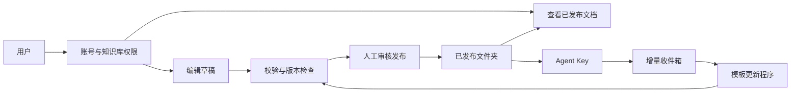

# 人与 Agent 共用的知识工作区

## 1. 目标与边界

在现有文件夹知识服务上加入账号、组织和文档工作区：人查看、整理并发布知识，Agent 读取已发布知识并提交增量材料。已发布内容仍是文件，账号、授权、草稿和审核记录存入 SQLite。

不引入第二套独立权限系统，不直接覆盖模板维护的文件，不在首版实现实时多人共编、Office 编辑或任意租户程序执行。



这是目标架构。第一阶段普通文档的草稿审核与模板候选审核分别保留记录；模板的人工作业接口完成后再统一候选协议。

## 2. 账号与权限

- 注册账号默认待审批；平台管理员启用后才能登录。使用密码哈希与有期限、可撤销的会话；浏览器令牌仅存内存。
- 平台管理员管理账号、组织及存量库归属。首版沿用管理员令牌，后续改为具名超级管理员和审计式应急入口。
- 组织管理员管理本组织成员与组织知识库。组织成员身份不自动授予所有库的阅读权；知识库可向组织成员单独授权。
- 个人知识库默认仅所有者可见，组织管理员没有隐式阅读权。平台运维人员拥有底层文件访问能力；首版不声称对平台运维实现内容保密。
- 知识库角色：读者（读）、编辑者（读、提交材料、保存草稿、送审）、发布者（再增加审核发布）、管理者（再增加成员授权）。个人所有者和组织管理员具有其管理范围的管理权限。
- 用户 Agent Key 不超过所有者当前权限与 Key 自身授权的交集；禁用用户、移出组织或撤销库权限后立即重新鉴权。旧管理员创建的 Key 继续作为平台级 Key；此兼容能力仅向平台管理员开放。
- 用户接口不开放全局模型、模板程序、仓库凭证、其他人的收件箱或任务目录。以后这些资源组织化时逐个补充归属与授权，不能仅过滤前端列表。

## 3. 文档工作区

第一阶段提供库列表、目录浏览、关键词搜索、Markdown 原位编辑与源码模式、草稿送审、差异预览与版本记录。草稿不出现在 MCP 读取结果中；审核发布后才对读取者生效。

保存草稿与送审分离；送审后候选不可改动。发布检查原始版本与当前授权，冲突返回明确错误，用户重新读取并整理草稿，不自动覆盖其他人的更新。编辑者不能自行升级为发布者；所有者可自行审核发布。

普通文档库由平台创建独立目录，通过完整候选快照和数据库挂载指针切换发布，保留旧版本。首版仅编辑小型 UTF-8 Markdown/文本文件，暂不提供文件删除、二进制附件或版本一键恢复。

存量挂载库支持授权后阅读。模板库与 Git 管理库暂不直接编辑；模板可能维护哈希、索引、出处，Git 库存在同步覆盖问题。

## 4. 后续接口与技术选择

| 工作 | 设计 |
|---|---|
| 模板支持人工编辑 | 模板声明 `human_edit` 能力；输入明确文件修改、原版本、操作者，程序验证并维护索引/元数据，输出标准候选。明确编辑不强制 LLM 改写 |
| Git 发布 | 候选转换为分支/提交，审核合并；统一与现有同步任务的版本锁 |
| 富文本 | 已采用 Milkdown / Crepe 原位编辑，支持段落格式菜单和源码模式；不支持的格式回退源码以保留原文 |
| 实时协作 | 有需求再用 Yjs/Hocuspocus，协作状态单独持久化，发布时导出文件 |
| Office | 需要 DOCX/XLSX/PPTX 时评估 ONLYOFFICE Docs，平台保留身份、文件与权限主控权 |
| 身份完善 | 具名平台管理员、密码找回/重置、SSO、注册频控与外部网关；上线公网前完成部署加固 |
| 多租户执行 | 模板 worker 的进程/容器、文件、网络与资源隔离。当前 trusted Python 不构成租户安全沙箱 |

## 5. 第一阶段验收

1. 待审批账号不能登录；退出或禁用后旧会话失效。
2. 组织隔离、个人私有、读/编/发布角色由后端验证；猜测资源 ID 不能越权。
3. 草稿不会改变已发布文件；发布后 REST/MCP 读取新版本，旧版保留。
4. 并发草稿、外部修改、授权撤销阻止过期候选发布；送审后不能悄悄改正文。
5. 用户 Key 的有效权限随用户权限收缩；Agent 不能直接发布文档。
6. 管理台可审批账号、管理组织与库归属；用户工作区可完成创建库、查看、编辑和审核。

## 6. 参考与取舍

- [Notion 分享与权限](https://www.notion.com/help/sharing-and-permissions)：借鉴工作区和页面协作体验，不复制其“最宽权限生效”策略。
- [飞书知识库权限](https://www.feishu.cn/hc/zh-CN/articles/821998241087-快速了解知识库权限)：借鉴组织、知识库分层。
- [DocSpace](https://github.com/ONLYOFFICE/DocSpace) 与 [Docs 集成架构](https://api.onlyoffice.com/docs/docs-api/get-started/how-it-works/)：完整协作平台与可嵌入编辑服务是不同选项。
- [Tiptap Markdown](https://tiptap.dev/docs/editor/markdown)：调研时为 Beta，必须验证现有 Markdown 无损往返。

## 7. 本次实现与使用

已实现第一阶段：账号注册/审批/禁用、8 小时会话及退出、组织成员、个人私有库、组织库角色、用户 Agent Key、Markdown 预览、草稿保存/送审/退回/发布和历史记录。文档暂限 Markdown / txt；最多 2000 个文件/目录，快照最大 32 MiB，单篇编辑最大 256 KiB。草稿列表最多返回最近 200 条。

1. 平台管理员打开 `/admin` → **账号与组织**。用户在 `/workspace` 注册，管理员启用账号。
2. 管理员创建组织，将已启用的账号设为组织管理员。组织管理员在用户工作区添加成员、创建组织库并分配库角色。普通用户可直接创建个人私有库。
3. 已挂载库通过管理台的“存量库归属”分配给组织，首版仅能分配尚无归属的库，不支持跨组织转移或个人库共享。
4. 在用户工作区打开文档，**编辑 → 保存为草稿 → 送审**。发布者查看修改对比，**审核并发布**。草稿正文与历史存于 SQLite，发布版本位于 `KB_ROOT/document-releases/<版本 ID>`，同一库的 REST/MCP 授权不变。
5. 用户在“我的 Agent Key”创建阅读/提交范围。Key 不具备文件编辑或审核发布能力。组织级服务身份及 Key 转移、有效期编辑留待下一阶段。

没有自动创建的用户或默认密码。管理员仍使用现有 `KB_ADMIN_TOKEN`。组织管理员不能访问 `/admin/api`，需要使用 `/workspace`。

### 部署与迁移

SQLite 自动迁移到 v7。升级前备份 SQLite 和知识目录，HTTP、Git worker、模板 worker 一并更新；旧代码不支持 v7，回退须恢复一致的备份，不要只替换程序。

默认 Compose 的整个知识目录仍为只读，若需要创建及发布普通文档库，额外挂载专用目录：

```bash
mkdir -p "$KB_SOURCE_DIR/document-releases"
docker compose -f compose.yaml -f compose.workspace.yaml up -d --build
```

需要模板 worker 时额外添加 `--profile updates`。原有 Git/模板任务继续使用原部署机制；专用文档目录不能绑定模板或 Git 更新，也不能与其他检索挂载重叠。只读部署可使用账号和阅读能力，创建/发布返回明确的存储不可写错误。

公网部署应使用 HTTPS 和网关；当前内置注册/登录频控按直连客户端地址限速，不信任客户端声明的转发头。密码找回、SSO、具名超级管理员、配额、完整审计查询、模板编辑接口和实时共编尚未实现。

### 验证记录（2026-09-24）

- 后端：156 项通过、2 项跳过，包含现有 MCP/REST、收件箱、模板更新回归及新增组织隔离、用户 Key 撤权、版本冲突与发布测试。
- 前端：6 项通过；TypeScript 与生产构建通过，仍有主包体积提示。Markdown 预览验证了原始 HTML、危险链接与远程图片不执行/加载。
- 浏览器：隔离数据下，两账号完成“编辑者修改 → 保存草稿 → 送审 → 审核者查看差异 → 发布”，并检查账号管理页面。
- Docker 在当前本机不可用，Compose 专用挂载方案需在 Linux 上完成部署验收；不将 Windows 本机验证等同于 Linux 多租户生产验收。

本地测试数据可通过 `python -m tests.human_ui_fixture` 单独生成，包含明确标记的合成账号与文档。该工具不读取或覆盖已有知识库。

### 文件浏览与正文编辑

- 知识库、目录统一使用文件列表：单击选择，双击或 Enter 打开；面包屑和“上一级”可逐级返回。搜索覆盖当前知识库正文。
- Markdown 使用 Milkdown / Crepe，可直接编辑标题、加粗、列表、表格及代码块，保留“正文 / 源码”切换；txt 使用纯文本编辑。
- 特殊 Markdown（元数据、HTML、图片、脚注、引用定义、本地链接）自动使用源码。正文模式初始化检查往返语义，失败回退；仅打开或切换模式不改写文件。
- 发布仍经过草稿和审核，保存并非立即发布；离开未保存内容会提示。原有 Git/模板管理的知识库仍只读。
- 本次未增加实时共编、图片上传和文件移动/重命名；目录浏览不等同于完整文件管理器。

本轮验证：相关后端测试 32 项通过、1 项跳过；前端 8 项通过，生产构建通过。独立测试库中实测单击选择/双击进入、两级目录与键盘打开、中文正文与表格修改、正文/源码切换、元数据保护、未保存提醒，以及双账号送审发布回读。修复了 CSP 下代码块样式缺失和最后一次输入在立即保存/切换时可能丢失的问题。
