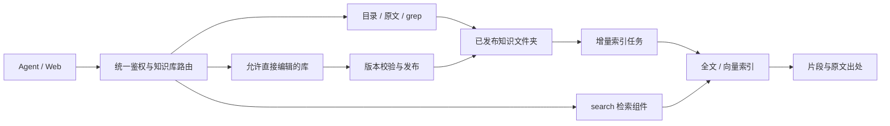
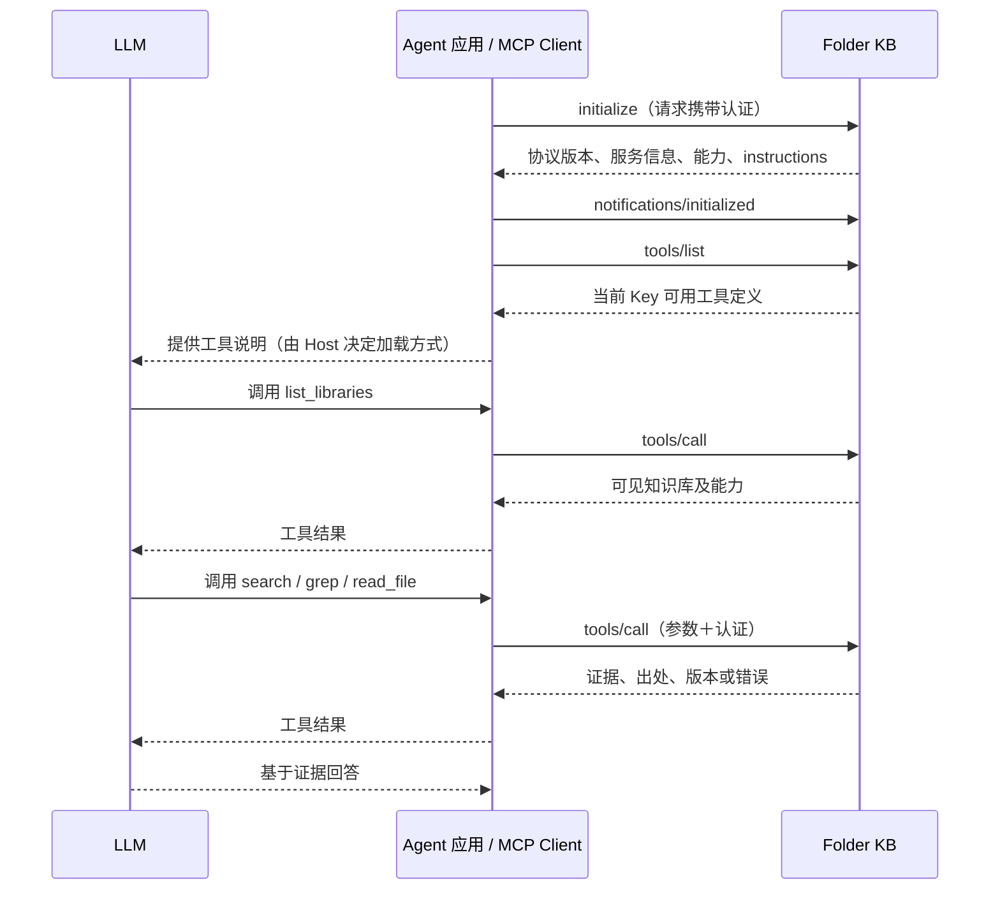

# 多知识库 Key 授权、检索与 MCP 上下文设计

日期：2026-10-01。状态：设计草案，尚未实施。本文中的接口示例为拟议契约。

## 1. 设计目标

保留一个 Key 通过 grep 访问多个知识库的能力；新增 search 和按需直接写入。知识仍以文件夹组织，Web 浏览与编辑不受 Agent 检索方式影响。

- 文件是正式知识，全文或向量索引是可重建的派生数据。
- 知识库定义支持的检索方式与写入策略，Key 按库配置授权。
- 同名 MCP 工具只提供一份，通过 library_id 路由，不为每个库复制工具。
- 知识插件可同时声明更新、索引和使用指引；平台分别执行这些能力。首版按库绑定一个插件版本，详见[插件设计与接口](plugins.md)。

当前实现已有固定的文件检索工具、多库授权和独立材料提交授权；按 Key 筛选工具列表、索引检索和 Agent 直接写入均为新增设计。

## 2. Key 的逐库授权 | 只读 |

文件访问包含目录浏览、文件名查找和原文读取。首版 grep/search 均依赖文件访问，保证检索结果可回到原文；不设计“只看片段、禁止读原文”的独立权限。

知识库配置 search 的实际实现：全文、语义或混合检索。Key 只决定是否允许 search，不让 Agent 每次选择算法；grep 和 search 可以同时授权。

写入策略首版三选一：只读、提交材料、直接编辑。个人库不默认获得直接写入权限，仍需所有者启用。模板或 Git 维护的库首版不允许绕过其更新流程直接写入。

有效能力 = 知识库支持能力 ∩ Key 授权 ∩ 所有者当前权限。直接编辑改变正式知识，要求与正式发布同级的用户权限，普通草稿编辑权限不够。已有平台级 Key 沿用平台管理规则，不虚构个人所有者。

```json
{
  "permissions": [
    {"library_id": "team-guide", "read": true, "grep": true, "search": true, "write_policy": "submit"},
    {"library_id": "personal-notes", "read": true, "grep": false, "search": true, "write_policy": "direct"},
    {"library_id": "project-guide", "read": true, "grep": true, "search": false, "write_policy": "readonly"}
  ]
}
```

配置保存到平台数据库，不在知识文件中保存 Key 或授权。全部权限在一个事务中保存，提供 policy_revision 识别授权变化。

## 3. MCP 与 REST 接口

### 工具暴露

| 工具 | 提供条件与行为 |
|---|---|
| list_libraries | 返回当前 Key 可见的库、用途、有效能力、可用状态与索引状态 |
| knowledge_info | 保留现有工具，返回指定库的格式、限制及使用约定 |
| list_directory / glob / read_file | 存在允许文件访问的库时提供 |
| grep | 至少一个库允许精确文本检索时提供 |
| search | 至少一个库授权且已配置索引检索时提供 |
| submit_material / get_submission | 存在材料提交授权时提供，回执仍按提交者隔离 |
| write_file | 至少一个库允许直接编辑时提供 |

工具列表取各库有效能力的并集。索引临时不可用时保留 search，返回明确的不可用/更新中状态，避免短暂故障引发工具列表反复变化。

每次调用重新检查目标库权限。只有 Key 恰好可访问一个库时允许省略 library_id；多库情况必须明确指定，不按“哪个库恰好支持这个工具”自动猜测。REST 与 MCP 共用授权和执行逻辑。

拟议的 list_libraries 单项：

```json
{
  "id": "personal-notes",
  "name": "个人笔记",
  "description": "用户的工作笔记与长期记忆",
  "capabilities": {"read": true, "grep": false, "search": true, "write_policy": "direct"},
  "search": {"mode": "hybrid", "status": "ready", "indexed_version": "v17"},
  "published_version": "v17",
  "policy_revision": 8
}
```

### 动态列表与撤权

当前 FastMCP 在应用启动时注册固定工具。改造时保留固定执行器，在 tools/list 中按当前请求的认证身份过滤，并在 tools/call 中再次鉴权；不能针对某个 Key 增删进程共享的工具注册表，否则会影响其他用户。

授权变更后，执行权限在后续调用立即重新判断；客户端缓存的工具描述不能作为授权凭据。新增工具可能需要客户端重新获取列表或重新连接。首版管理台提示重新连接，不承诺客户端自动刷新；后续再验证工具变更通知与各客户端的兼容性。当前无状态 HTTP 部署不应直接宣称已支持主动通知。工具目录缓存必须按认证身份及授权版本隔离。

## 4. 搜索与直接写入



### search

输入 query、library_id、可选相对目录 path、limit 与分页游标；输出片段、文档标识、相对路径、章节/原文位置、文档版本、索引版本及实际检索模式。不由 search 直接生成答案，Agent 或后续 Web 问答层负责基于证据回答。

检索组件提供全文、语义和混合实现，平台规定输入输出，不把具体引擎写入 Key。首版可评估独立索引 worker 与 Qdrant；最终按中文术语、自然语言问题的检索效果和部署成本选型，暂不引入知识图谱。

只索引挂载的检索目录，不索引模板的完整工作目录、辅助元数据或未发布草稿。检索前按有效知识库及目录范围过滤，返回前再次验证权限、文档存在性和版本，不能先召回其他组织内容再交给 LLM 过滤。

发布、Git 同步及直接写入触发增量索引；外部维护目录通过变更检测与定期核对补齐。以文档标识和内容哈希处理新增、修改、删除。迁移路径时保留平台管理文档的稳定标识；外部文件无法识别重命名时可按删除与新增处理。

内容版本与索引版本分别记录。新版本未索引完成时显示更新中，不把旧片段当作当前证据；可返回 index_not_ready。只有同一 Key 同时获准 grep，且已配置回退策略时，才能明确告知调用方后回退文件检索。失败可重试，不阻塞原文查看。

### write_file

首版只支持原生知识库中的 UTF-8 文本创建和替换，不支持删除、移动、任意二进制写入或执行程序。

输入 library_id、path、content、operation（create/replace）、expected_version 和 request_id。替换必须带读取时的版本；创建必须验证路径不存在。返回新文档版本、发布版本和索引状态。重复 request_id 的相同请求返回原结果，不同内容返回冲突。

复用现有候选快照、历史版本及发布指针机制，以事务或锁保护基准版本比较与发布切换。权限校验应覆盖最终发布，两个写入不能都基于同一旧版本成功覆盖。这里只免去人工审核，仍保留校验、历史和审计；写成功不等于索引已经完成。

首版仅平台管理的原生库开启此能力，继续约束相对路径、文件类型和大小，不扩大整个挂载根的写权限。模板库与 Git 库通过各自更新流程处理。被同一物理目录的其他挂载视图绕过写入策略的情况也必须拒绝。

## 5. MCP 如何进入 Agent 上下文

### 连接与调用

MCP 是客户端与服务端交换能力和结果的协议，不是操作系统文件夹挂载。Host 是运行 Agent 的应用，Client 是其中连接 MCP 的组件，Server 是我们的知识服务；LLM 提出工具调用，Host/Client 执行网络请求并把结果送回模型。[官方架构说明](https://modelcontextprotocol.io/docs/2025-11-25/learn/architecture)

以下按当前安装的 MCP Python SDK v1 所支持的 2025-11-25 协议说明，不将该流程泛化为所有新版本协议；实际版本需要客户端与服务端协商，升级 SDK 时重新验证。



初始化只交换服务信息与能力，instructions 是可选的服务使用说明，不是全部知识正文。[生命周期规范](https://modelcontextprotocol.io/specification/2025-11-25/basic/lifecycle)

### 哪些信息模型能看到

| 信息 | MCP 如何提供 | 是否自动成为模型上下文 |
|---|---|---|
| 服务名、版本、支持哪些能力 | 初始化结果 | 主要供客户端使用，不保证原样交给模型 |
| 服务使用说明 instructions | 初始化结果 | Host 决定是否纳入及放在哪种上下文中，不是强制系统指令 |
| 工具名、用途、参数类型与必填项 | tools/list 的 name、description、inputSchema；可含 outputSchema 和 annotations | 通常被转为模型可用工具，也可能延迟发现/按需加载 |
| 可访问库名、用途、逐库能力 | 本平台 list_libraries 工具结果 | 工具调用后，由 Host 提供给模型；不是 MCP 自动扫描得到 |
| 搜索片段、文件正文、版本、执行错误 | tools/call 的 content / structuredContent、isError 等 | Host 通常作为工具结果提供，可能裁剪、摘要或转为附件 |
| 文件等资源 Resources | resources/list、resources/read | 是否读取和加入上下文由 Host 决定，不会列出即自动全文注入 |
| 可复用提示模板 Prompts | prompts/list、prompts/get | 通常由用户或客户端选择使用，不自动变成全局提示词 |
| API Key、Authorization 请求头 | 客户端传输层配置 | 本平台不放入工具参数、描述或结果，模型无需知道密钥 |
| 整个知识文件夹 | 不自动传输 | 只有主动读取、检索或客户端显式附加的内容才可能进入上下文 |

工具定义与工具结果是两类不同的信息；annotations 只是行为提示，不替代后端权限。具体字段见[Tools 规范](https://modelcontextprotocol.io/specification/2025-11-25/server/tools)。资源和提示模板的上下文使用方式分别见[Resources](https://modelcontextprotocol.io/specification/2025-11-25/server/resources)、[Prompts](https://modelcontextprotocol.io/specification/2025-11-25/server/prompts)。

本平台当前主要使用 Tools 与服务 instructions，未把每个知识文件注册为 Resource，也未提供独立 Prompt 模板。首版继续如此，避免维护两套重复入口。

### Agent 实际看到的简化示例

```text
服务说明：先列出知识库，查看每个库允许的操作；搜索命中后读取原文核对。

工具：search
用途：在指定知识库检索相关片段，返回出处；多库时必须指定 library_id。
参数：query、library_id、path、limit。

调用 list_libraries 后：
  team-guide：团队手册；允许 read、grep、search、submit。
  personal-notes：个人笔记；允许 read、search、write。

调用 search 后：
  路径：guide/config.md；章节：参数设置；版本：v17。
  片段：……
```

以上是示意，不是固定系统提示词。MCP 不负责训练模型，也不保证跨会话保存记忆。工具说明、已加载的库目录和检索正文都会消耗模型上下文；同名工具只定义一次，库目录分页，正文按需读取。平台不假设所有客户端都支持延迟加载。文档和用户提交内容仍是待判断的数据，不应被客户端当成高优先级指令。

## 6. 迁移与验收

| 顺序 | 工作与验收 |
|---|---|
| 1 | 扩展逐库能力授权和管理 UI；旧 Key 自动保留文件访问、grep 与既有提交授权，不新增 search/direct 权限；原工具名与 REST 行为兼容 |
| 2 | 实现按 Key 筛选 tools/list、调用时鉴权及逐库能力发现；两个不同 Key 并发列工具不串权，撤权后缓存客户端也不能继续执行 |
| 3 | 一个知识库试点 search：发布→增量索引→检索→原文定位；验证新改删、索引故障、权限过滤与版本一致性 |
| 4 | 原生个人库试点 write_file：验证创建/替换、幂等重试、并发冲突、修改历史、撤权及索引更新；模板/Git 库拒绝直接写入 |
| 5 | 用实际 MCP 客户端验证说明和工具结果是否进入上下文、权限变化后的刷新方式；REST 执行同一授权测试 |

本次只确定接口与权限方向，不改动运行服务。百人级性能需求继续单独待办，不能把新增索引或多进程视为已经通过容量验收。
