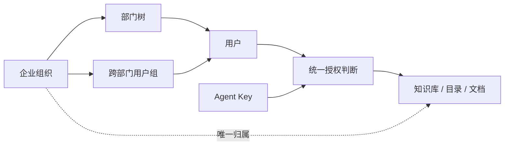

# 组织与权限管理系统设计

日期：2026-10-01。本文区分目标设计和分阶段交付，未标记完成的能力不代表已经上线。

## 1. 目标与现状

让人和 Agent 使用同一套知识库权限，支持组织协作、个人私有知识和跨部门项目。知识内容继续存为文件，身份、归属、授权及审计存于平台数据库。

制定本方案时，已有账号注册/审批、平级组织、组织管理员/成员、逐人库角色、个人 Key 与逐库工具权限。主要缺口是库归属不能变更、普通成员需逐人授权、没有部门树和用户组，组织管理与内容管理权限绑定过紧。第一阶段已补齐归属管理和组织全员可读，第二阶段已接入部门树和用户组，交付见第 9、10 节。

## 2. 业务模型

| 对象 | 职责 |
|---|---|
| 平台 | 账号、组织生命周期、全局运行资源及审计 |
| 企业组织 | 数据隔离边界；同一账号可以加入多个组织 |
| 部门 | 组织内部的树形结构；成员可加入多个部门，主部门仅用于展示 |
| 用户组 | 跨部门的项目、岗位或协作组；首版手动维护，动态规则后续考虑 |
| 知识库 | 唯一归属为组织、个人或平台托管；共享授权不改变归属 |
| 授权 | 主体（用户、部门、用户组、组织全员）＋资源＋角色＋作用范围 |
| 服务账号 / Agent Key | 服务账号是身份，Key 是可撤销凭据；工具权限进一步限制资源权限 |

部门树组织人员，文件夹树组织知识，二者不要求一一对应。子公司需要独立隔离时设为独立组织，否则用部门层级表达；首版不开放跨企业组织共享。

## 3. 权限规则

### 人员、内容和管理范围

- 组织管理员管理本组织成员、部门和用户组；目标模型中内容访问由单独授权决定。当前自动管理全部组织库的行为先兼容保留，迁移时显式生成内容管理授权，不能静默收权或扩权。
- 部门管理员的角色包含管理范围：本部门或本部门及下级。管理人员的权限不自动变成阅读下级全部知识的权限。
- 库角色继续使用读者、编辑者、发布者、管理者。创建草稿与提交材料要求编辑者；正式发布和 Agent 直接写入要求发布者；共享配置要求管理者。
- 多条有效授权取能力并集；组织隔离、账号禁用、资源停用、Key 限制是硬边界。首版不增加单人 deny 覆盖，避免难以理解的优先级。
- 部门授权明确是否包含子部门；不默认让父部门人员读到子部门所有库。目录授权默认向下继承，后续提供“停止继承”；文件级例外在库级规则稳定后实现。
- 个人库默认仅所有者可见，组织管理身份不能隐式访问。平台应急访问以后使用具名身份和审计；当前平台管理员及底层运维仍具备访问能力。

### 可见性与权限来源

知识库提供“指定成员可访问”和“组织全员可读”。组织全员可读只给读权限，编辑/发布仍需单独授权。取消某人的直接授权不会抵消组织全员可读，界面必须明确显示这一点。

页面展示有效角色及来源，例如“读者：组织全员”“编辑者：项目 X 用户组”。后续增加“以某成员查看权限”与访问诊断，避免只显示授权记录而不显示实际结果。

### Agent

有效权限 = 身份对资源的权限 ∩ Key 配置 ∩ 知识库支持能力。读、grep、search、submit、direct 由同一授权入口检查；不靠隐藏工具实现隔离。

个人 Key 跟随所有者权限；组织长期任务使用服务账号，避免员工离职影响无人维护的凭据。组织/个人拥有者、有效期、撤销、轮换和操作审计应覆盖 Key 全生命周期。平台级旧 Key 在兼容阶段明确标识，不伪装为个人 Key。

## 4. 知识库归属变更

区分取消共享、组织内调整管理部门、跨组织转移、移入平台托管和归档，任何一种都不等于删除知识文件。

第一阶段仅平台管理员执行组织库转移和移出。移出后进入“平台托管”，用户工作区不可见；可再次分配给组织。平台原生库保留其存储类型，不因移出变成外部挂载库。个人库转移需后续所有者确认流程，本阶段不开放。

变更前检查并展示目标与影响；写入携带归属版本防止并发覆盖。进行中的更新任务、未处理收件箱材料或未完成草稿阻止转移，先处理完成再操作。跨范围共享工作目录的插件库先拒绝，避免只转移一个检索视图而遗留同一实体的其他视图。

变更在同一事务中完成：

1. 验证当前归属、目标组织、目录隔离和在途工作。
2. 清除原库的逐人、部门、用户组授权及所有 Key 对此库的授权（包括平台 Key），Key 对其他库的授权保留。
3. 恢复“指定成员可访问”，关闭 Agent 直接写入与自动增量触发。
4. 切换归属，保留文件、已完成记录与历史版本，记录操作者、前后归属及影响数量。

新组织管理员再授权成员与 Key。移出后不能把已解除授权的历史回执当成访问入口。

## 5. 数据与接口

部门和用户组已使用 `organization_units(kind,organization_id,parent_id,revision)`、`unit_members` 统一存储；库级授权使用 `library_unit_grants(role,include_descendants)`。组织成员关系由复合外键约束，跨组织引用在同一事务中校验。后续增加统一 `resource_grants`、`admin_scopes`、`service_accounts`。

第一阶段先增加 `library_governance` 保存全员读取策略、归属版本和托管时的原生存储标记，保留现有逐人授权表。以后迁移到统一授权表，避免同时维护两套有效权限判断。

| 接口 | 用途 |
|---|---|
| GET/PUT `/admin/api/libraries/{id}/governance` | 查看/转移/移出归属；写入 organization_id（null 为平台托管）及 expected_revision |
| GET/PUT `/portal/api/libraries/{id}/sharing` | 库管理者配置指定成员或组织全员可读；写入需 expected_revision |
| GET/PUT `/portal/api/libraries/{id}/members` | 现有逐人授权继续有效 |
| GET/POST `/portal/api/organizations/{id}/units` | 部门和用户组列表、新建；仅组织管理员或平台管理员 |
| PUT/DELETE `/portal/api/organizations/{id}/units/{unit_id}` | 设置名称、上级、直属成员 / 删除；要求 expected_revision |
| GET `/portal/api/libraries/{id}/unit-grants` | 当前部门/用户组授权及可选主体；仅库管理者 |
| PUT `/portal/api/libraries/{id}/unit-grants/{unit_id}` | 设置角色、是否含下级 / role=remove 撤销；要求 expected_revision |
| 后续 grants / effective-permissions | 统一资源授权及权限诊断 |

旧 ownership 接口仅保留首次分配兼容入口，不借此绕过新的范围校验和授权清理。REST、MCP、用户工作区和后台发布都必须复用相同权限判断。

## 6. 管理界面

- 侧栏独立提供账号管理、组织管理和知识库归属；归属列表显示当前组织和平台托管状态，操作通过弹窗完成。
- 知识库：成员权限提供共享模式和逐人授权；工作区顶部直接提供成员权限入口，不藏在视图菜单深处。
- 组织详情：成员与部门共用左树右表，用户组为同级标签；从组织上下文进入。管理员范围和服务账号后续补齐。
- 转移弹窗明确提示将清除库授权、保留文件；失败保留输入，不悄悄改为部分成功。

## 7. 实施顺序与验收

| 阶段 | 任务点 | 验收 | 状态 |
|---|---|---|---|
| M1 | 库转移/移出/重新分配；组织全员可读；授权入口 | 文件不丢；旧成员/Key 失权；新组织不继承旧权限；私人库不扩权；并发/在途任务受控 | 已实现，已验证 |
| M2 | 部门树、成员管理、用户组 | 禁止循环和跨组织挂接；调动后权限随授权范围变化；跨部门项目授权可用 | 已实现，已验证 |
| M3 | 统一资源授权、管理范围、权限来源 | 各接口结论一致；取消直接授权仍显示继承来源；管理成员与读内容可以分离 | 待做 |
| M4 | 组织服务账号、Key 归属、交接与轮换 | 员工退出后不能继续使用个人 Key；组织服务身份可独立治理 | 待做 |
| M5 | 具名平台管理、SSO、账号恢复、审计界面 | 登录与业务授权分离；应急访问有记录；注册和离职闭环 | 待做 |

不安排逐日日程；按阶段完成测试和本地提交。每次数据库迁移前备份，旧库默认维持受限共享，不自动改成全员可读。现有组织管理员行为在 M3 显式迁移前保持不变。

## 8. 技术选型与参考

先集中当前 Python/SQLite 的授权逻辑，不为首阶段增加服务依赖。身份系统需要企业单点登录时评估 Keycloak；目录级继承和复杂共享成熟后再评估 OpenFGA，迁移前以测试固定权限语义。百人并发性能仍需单独验收。

- [飞书知识库成员](https://www.feishu.cn/hc/zh-CN/articles/530997871518-设置当前知识库管理员和成员)：按成员、部门等主体授权。
- [Notion 空间与群组](https://www.notion.com/help/guides/grant-access-teamspaces)：人员分组与内容空间分离。
- [Keycloak](https://www.keycloak.org/docs/latest/server_admin/index.html#_groups)：身份、角色和层级群组。
- [OpenFGA](https://openfga.dev/docs/modeling/parent-child)：资源关系与继承授权。

## 9. 第一阶段交付记录

- 管理台：知识库归属，支持移入平台托管和重新分配/转移组织；个人库显示为不可转移。
- 用户工作区：打开组织库 → 顶部成员权限，可选择组织全员可读，继续逐人设置编辑、发布和管理权限。
- SQLite 自动升级为 v9；原库默认受限，原生库移出后保留存储标记。升级前备份管理数据库，运行进程一并更新。
- 已验证归属 CAS、跨组织隔离、旧 Key 撤权、原生库再次分配、私人库限制、未完成草稿/材料阻断，以及共享模式切换后的实时读取权限。
- 第一阶段未包含部门树与用户组；第二阶段进展见下。组织管理与内容管理分离、服务账号和 SSO 按 M3–M5 继续。

## 10. 第二阶段：部门树与用户组

- 管理入口：组织管理 → 选择组织 → 成员与部门 / 用户组。支持新建、重命名、调整部门上级和直属成员、删除；用户组没有父子层级，可包含不同部门的组织成员。
- 授权入口：组织库 → 成员权限 → 部门与用户组。部门默认仅直属成员，可显式包含下级（包括今后新增的下级）；用户组按直接成员生效。
- 示例：给“研发部（含下级）”读者，给“交付项目组”编辑者。研发部下的算法组成员可读；同时在项目组则可编辑。移出项目组后恢复为读者。
- 有效角色取个人、部门、用户组和全员共享中的最高角色，取消其中一项不等于撤销所有访问。沿用现有组织管理员权限；详细权限来源和管理范围拆分在 M3 实现。
- 用户和个人 Key 每次访问都检查当前身份权限。调动部门或调整组成员立即影响后续请求；移出组织清除部门/组成员关系，再加入不会自动恢复。移库清除部门/组授权。
- 同级部门、用户组名称不可重复；禁止跨组织挂接、循环和超过 16 层的部门。每组织最多 2000 个部门/组，每个部门/组最多 1000 名直属成员。含下级部门不能直接删除，先移动或删除下级；删除叶节点清除关联及授权，不删除账号、知识文件。
- SQLite v10 增量迁移，不改变旧库权限。修改带版本号，防止旧表单覆盖新成员或新归属；新建、修改、删除和授权写入审计记录。

本阶段不提供部门管理员、动态用户组、主部门、跨组织用户组、目录级授权和显式拒绝规则。

验收：204 项后端测试通过、2 项跳过；17 项前端测试通过，构建成功。隔离浏览器验证了父子部门、直属成员、用户组、含下级授权、组编辑授权，以及共享与组授权连续保存。

## 11. 成员管理界面调整

- “成员与部门”采用左侧部门树、右侧成员列表；提供全部成员、未分配部门、搜索、角色筛选和可选的包含下级部门。成员列表直接显示部门及用户组。
- 添加成员和新建组织通过弹窗完成；点击成员打开侧栏，一次保存组织角色、部门和用户组。部门菜单支持设置、新增下级和删除。用户组只保留一个同级标签，点击组查看成员。
- 工作区外壳固定，部门树与成员内容分别滚动；低频操作放入行内菜单。组织角色使用“组织管理员 / 成员”，避免与知识库角色混淆。
- GET/PUT `/portal/api/organizations/{oid}/members/{uid}/profile` 用于成员详情。PUT 校验原角色及分组快照后，在同一事务中保存；不覆盖其他成员的变动，并递增受影响部门/组的版本。保留同组织、有效账号、最后一位管理员及成员数限制。
- 本轮调整成员管理交互；知识库统一授权及有效权限来源仍按 M3 实施，现有授权计算不变。

组织管理已拆为独立导航页，去掉外层卡片、重复大标题和用户工作区跳转按钮。账号管理、组织管理、知识库归属分别从侧栏进入；旧 `#people` 链接兼容打开组织管理。组织页面使用全部内容宽高，部门树、成员区和侧栏菜单分别滚动。
