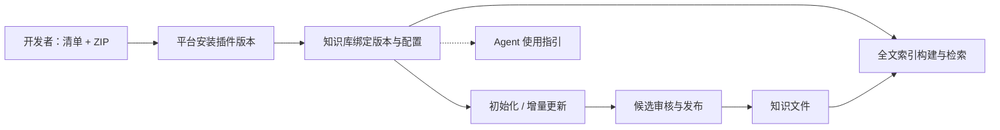

# 知识插件：定义、安装与接入

## 1. 概念和边界

**知识插件是知识库开发者提供的、带固定版本的扩展包。** 它可定义知识如何初始化、更新、建立检索索引，以及 Agent 如何使用这些知识。原来的“更新模板”是其中一种插件。

| 对象 | 职责 |
|---|---|
| 插件版本 | 清单、程序包、配置规范、能力声明；安装后不可覆盖 |
| 知识库实例 | 文件目录、归属与权限、绑定的插件版本及实例配置 |
| 平台 | 安装校验、运行资源、模型连接、任务与发布、检索路由、来源校验和鉴权 |
| Agent Key | 决定可访问哪些库、调用哪些能力；插件声明不能授予权限 |

**Search 的算法由插件决定。**平台不定义统一的分块、分词或排序策略；运行协议见 [Search 插件协议 1.0](search-plugin-protocol.md)。

一个知识库可分别绑定一个知识管理插件版本和一个检索插件版本，一个版本可服务多个知识库。未独立配置检索时兼容原管理插件内的 indexing；显式停用检索不会回退。文件始终是知识的正式来源，索引是可重建的派生数据。绑定关系保存在平台，知识仓库无须包含平台元数据。详见[插件组合与编辑](plugin-composition-and-editing.md)。



初始化、更新与检索通过各自运行接口接入；Agent 指引在 MCP 初始化时按 Key 可见知识库装配，不代表 Agent 一定执行，也不授予额外权限。

## 2. 本版交付范围

| 能力 | 当前状态 |
|---|---|
| 清单校验、ZIP 安装、版本列表与详情 | 已实现 |
| 知识库绑定、配置校验、解除绑定 | 已实现 |
| 初始化与增量更新程序 | 复用现有处理队列；需要协议 1.1、update 能力、明确启用与程序包摘要审批 |
| 索引规则及自定义索引入口 | 支持声明式全文兼容后端和 search_protocol 1.0 程序插件；程序负责构建、查询和排序，平台统一提供 REST/MCP |
| Agent instructions | 按 Key 可见知识库装配 MCP initialize.instructions |
| 插件升级 | 安装新版本后显式改绑；不自动覆盖旧版本 |
| 插件卸载 / 自动发现市场 | 本版不提供；可解除绑定，保留安装包及记录 |

单独安装、绑定不会启动程序。原生文档库允许绑定纯索引/指引插件，继续使用原有文档编辑与发布流程；首次接入更新模板需通过知识库配置流程接管独立工作目录。新建模板库启用更新后会排队自动初始化，增量更新仍需人工审核。详见[模板与更新管理](library-template-workflow.md)。

## 3. 插件清单

开发者提交 `plugin.json` 和 `package.zip`。为复用现有程序运行协议，顶层保留 `capabilities`、`entrypoints`、`runtime` 等字段，通过 `plugin` 声明新增能力。

```json
{
  "id": "my-memory",
  "version": "1.0.0",
  "protocol_version": "1.1",
  "name": "个人记忆",
  "maintainer": "开发者",
  "source": {"type": "uploaded-zip", "archive_sha256": "打包工具生成的64位摘要"},
  "capabilities": ["initialize", "update"],
  "entrypoints": {
    "initialize": ["python", "program.py", "initialize"],
    "update": ["python", "program.py", "update"]
  },
  "runtime": {"type": "trusted-python-demo"},
  "output": {"directory": "workspace", "required_files": ["INDEX.md"]},
  "config_schema": {"type": "object", "additionalProperties": false},
  "plugin": {
    "manifest_version": "1.0",
    "instructions": "需要回顾用户偏好或项目决策时，先查找相关记忆。",
    "indexing": {
      "mode": "hybrid",
      "splitter": "markdown_sections",
      "include": ["**/*.md"],
      "exclude": ["archive/**"],
      "metadata_fields": ["topic"]
    }
  }
}
```

- `capabilities` 对应程序操作，取 `initialize`、`update`。索引、指引通过对应配置是否存在来声明，不重复维护开关。
- 只声明索引规则或指引时，`capabilities: []`、`entrypoints: {}`、`runtime.type: declarative`。至少声明一种能力。
- `protocol_version` 是程序输入输出协议；`plugin.manifest_version` 是新增能力清单版本，两者独立。
- `indexing.mode`：`fulltext`、`semantic`、`hybrid`；`splitter`：`document`、`markdown_sections`、`custom`。`custom` 必须提供包内 Python 入口并使用程序运行环境。声明 `search_protocol: "1.0"` 后按检索协议执行；不带该协议的旧入口仍只保存声明。
- `include/exclude` 相对知识检索目录，禁止绝对路径、父目录跳转。后续消费者须统一采用 `**` 可匹配零层目录的 glob 语义，并始终继承平台隐藏路径规则；插件不能扩大读取范围。
- `instructions` 最多 8,000 字符。它表达用途与建议，不是权限和强制执行保证。
- `required_secrets` 只声明变量名；实例配置不放 API Key。调用模型沿用管理台“模型连接”和更新设置中的环境变量映射。

完整约束以 `GET /admin/api/plugins/schema` 的 JSON Schema 为准。

## 4. 安装与绑定接口

以下管理接口使用平台管理员令牌；Agent Key 和普通账号不能调用。个人所有者及组织管理员可通过工作区接口选择平台已授权的资源配置所属知识库，见[模板与更新管理](library-template-workflow.md)。

| 方法 | 路径（均以 `/admin/api` 开头） | 用途 |
|---|---|---|
| GET | `/plugins/schema` | 获取清单规范 |
| POST | `/plugins` | 注册清单，返回 `registered`；相同定义可重复提交 |
| PUT | `/plugins/{id}/versions/{version}/package` | 直接上传 ZIP 二进制；成功后 `installed` |
| GET | `/plugins?offset=0&limit=50` | 分页列出版本、能力接入状态和已绑定知识库 |
| GET | `/plugins/{id}/versions/{version}` | 获取版本详情 |
| GET / PUT / DELETE | `/libraries/{id}/plugin` | 查询 / 保存 / 解除绑定 |

绑定请求：

```json
{
  "plugin_id": "my-memory",
  "plugin_version": "1.0.0",
  "config": {}
}
```

默认只使用当前知识目录；更新程序需要仓库其他文件时可附加 `workspace`，沿用[完整工作范围协议](template-protocol.md)。索引规则始终基于知识检索目录。原生文档库不接受自定义工作范围。

响应中的 `capabilities.*.integration` 为 `available` 或 `definition_only`，分别表示已有运行接入与仅保存定义；`available` 不代表该知识库已经启用更新策略。

清单及绑定请求上限 64 KiB，实例配置上限 32 KiB；ZIP 压缩包与解压总量各不超过 32 MiB，最多 2,000 项。安装校验 SHA-256、路径、链接和入口；不执行包内脚本。更新程序走既有 worker、包摘要批准与候选审核流程；检索程序单独启用并按程序摘要批准，索引验证后发布，无知识文件写入。`trusted-python-demo` 仅适合管理员信任的本地程序，不是隔离沙箱。

原 `/templates` 和 `/libraries/{id}/template` API 保留，使用相同存储和绑定记录；旧 `registration.json` 可直接安装，不必重新制作程序包。

## 5. 开发与管理台使用

无需编写程序的示例位于 `examples/plugins/personal-memory`。在项目环境中打包：

```bash
python -m folder_kb.plugin_package \
  --source examples/plugins/personal-memory/package \
  --definition examples/plugins/personal-memory/definition.json \
  --output /tmp/personal-memory-plugin
```

输出目录必须不存在，产物为 `plugin.json` 和 `package.zip`。清单放在 ZIP 外，由打包工具补全压缩包摘要。

管理台：**插件 → 安装插件 → 导入清单与选择 ZIP → 安装**。安装失败保留输入，已注册版本可以继续上传。然后在 **知识库 → 插件配置** 选择版本并保存。更新型插件再进入“更新设置”配置模型、审批程序包并启用；检索插件可在“检索索引”中构建和测试；程序插件需先启用运行环境并批准程序摘要。

## 6. 检索执行

参见 [Search 插件协议](search-plugin-protocol.md)。平台按库路由到绑定程序，程序自行存储索引与查询；返回规范的原文片段、路径和行号。平台校验来源、范围及内容版本，不对结果重排。

旧 [简易 RAG 插件](simple-rag.md) 和 `examples/plugins/simple-rag-python` 保留兼容，新安装推荐 `bm25-markdown`。插件可以选择全文、语义或混合算法，但只有接入支持的检索实现并构建成功后才可检索；程序实现还须批准执行。


## 标准基础插件

新安装推荐 `bm25-markdown@1.0.1`（独立 BM25 全文检索）或 `general-knowledge@1.1.2`（分类 Markdown 模板＋增量更新＋BM25）。个人记忆使用独立仓库的 `memory-files`，大规模语料评测使用 `sqlite-corpus`；`personal-memory-guide` 仅为声明示例。完整清单、源码和操作步骤见[插件目录](../examples/plugins/README.md)。原 `simple-rag` / `simple-rag-python` 是兼容 ID，已安装版本保持不变，避免破坏绑定与历史评测的可复现性。

通用知识库 1.1.2 使用 `model_binding` 声明 llm 模式的模型依赖和变量映射。平台派生默认映射并在配置、入队和运行阶段校验；不把密钥写入插件或实例配置。已有 1.1.x 工作目录可升级绑定，无需重新初始化。

## 编辑与组合扩展

知识管理与检索现在支持独立绑定；管理插件可声明允许直接编辑或仅通过管线修改。契约、兼容行为与验收内容见 [插件组合与文档编辑](plugin-composition-and-editing.md)。
