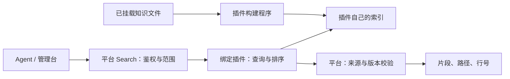

# Search 插件协议 1.0

**插件决定索引和检索方式，平台只提供运行协议、权限边界与结果校验。** 分块、分词、embedding、查询改写、召回和重排均属于插件；平台不解释业务词义，不重排插件结果，不将所有查询转成 BM25。

## 职责与调用



- 平台提供挂载目录内、符合 include/exclude 的完整文本快照；不提供父仓库、私人目录或其他库。文件仍是正式知识，索引是可重建的派生物。
- 插件独立生成索引产物，决定查询算法及顺序。平台保持原始 query，不执行额外分词，不把插件返回的 score 当作通用置信度。
- REST/MCP 共用 `search(query, library_id?, limit=5, path=".")`。`path` 是可选目录过滤，需插件声明支持；插件必须在召回/排序阶段处理，平台只检查结果没有越界，不做 Top-K 后过滤。
- 搜索结果包括 `results`、`has_more`、`index_status`、`content_version` 和 `scope`（目录、包含/排除规则、索引文件数）。`has_more` 指本次算法的候选超过 limit；无命中、has_more=false 均不能证明资料不存在。

## 清单

在既有插件清单的 `plugin.indexing` 中声明：

```json
{
  "mode": "fulltext",
  "splitter": "custom",
  "entrypoint": ["python", "search.py"],
  "search_protocol": "1.0",
  "supports_path_filter": true,
  "include": ["**/*.md", "**/*.txt"],
  "exclude": ["drafts/**", "archive/**"]
}
```

`mode` 可为 fulltext、semantic、hybrid，仅表达插件能力，不选择平台算法。此版本运行时为 `trusted-python-demo`。没有声明 `search_protocol` 的旧 custom 入口仍是预留声明，不会突然执行。原 `simple-rag/1.0.0` 保持兼容，走独立的 `legacy_search.py` 后端；新插件不应依赖该后端。

## 程序输入输出

统一启动命令：`python -I -B <安装包入口> --input <request.json> --output <输出目录>`。入口的其他固定 argv 来自清单，不经 shell。程序仅使用收到的路径，不依赖当前工作目录。

公共输入：`protocol_version: "1.0"`、`operation`、`library_id`、`content_version`、实例 `config`、`indexing`。

| 操作 | 额外输入 | 必须输出 |
|---|---|---|
| build | `documents: [{path, text, sha256, version}]`，`index_dir: null` | `index/` 目录和 `result.json` |
| search | 原始 `query`、`limit`、`path`、`index_dir`（已发布索引的临时副本） | `result.json` |

构建结果严格为：

```json
{"protocol_version":"1.0","engine":"my-retriever-v1","chunks":12}
```

检索结果严格为：

```json
{
  "protocol_version": "1.0",
  "has_more": false,
  "results": [{
    "path": "docs/example.md",
    "start_line": 2,
    "end_line": 3,
    "title": "连接说明",
    "text": "来自这些行的连续原文片段",
    "score": 0.8
  }]
}
```

插件返回的是证据，不能用生成的答案替代原文。平台校验路径属于输入快照及查询目录、行号有效、片段确实出自指定行；附加当前文件 SHA 和版本。分数必须是有限数字，平台保持插件的结果顺序。程序不得改写输入或安装包。

## 执行、发布与限制

安装/绑定不会执行程序。运行需管理员同时配置：

```bash
export KB_SEARCH_TRUSTED_PYTHON=1
export KB_SEARCH_PLUGIN_ALLOWLIST=<安装后返回的package_sha256，多个用逗号分隔>
```

批准的是安装后程序树摘要，不是 ZIP 摘要。查询和构建都复核批准项及程序摘要；撤销批准立即阻止后续执行。`available` 表示支持协议，并不表示运行环境已启用。

这是可信本地 Python 进程，不是沙箱：代码仍具有服务进程账号的系统权限。当前不执行 container runtime，不继承用户模型凭证，也未接入 Search 专用模型连接映射。不要安装不可信代码；容器隔离与模型授权注入须另行实现。

- 当前原文上限沿用 1,000 文件、16 MiB，扫描最多 15 秒；这是首版执行配额，不是插件算法定义。
- 索引产物与临时输入/输出树各最多 64 MiB、2,000 项；结果 JSON 最多 1 MiB；每条原文片段最多 8,000 字符，标题最多 300 字符。
- 查询最多 200 字符、最多 10 条结果。进程预算取清单值与平台上限的较小值：构建 300 秒、查询 30 秒。超时终止进程树；异常不会将 stderr 或凭证回传给 Agent。
- 新索引验证后原子切换指针；构建失败保留旧索引。旧索引若源文件已经变化，仍报 stale，不能继续返回旧知识。
- 文件、绑定或实例配置变化需重建；查询前后检查快照。索引按库隔离，保存在 `KB_STATE_DIR/indexes/<库ID摘要>-generations/<generation>/`，指针为同级 `<库ID摘要>.plugin.json`。
- 查询使用索引副本，避免插件修改已发布产物。成功构建的旧代暂保留，后续需补引用安全的回收机制；当前为小规模同步执行，尚不适合高并发或大型向量索引。

## 示例与验收

完整可运行示例：`examples/plugins/bm25-markdown`。其程序自行完成 Markdown 分块、SQLite FTS5、BM25、目录过滤及 has_more；只依赖 Python 标准库，未宣称具备向量检索。

```bash
python -m folder_kb.plugin_package \
  --source examples/plugins/bm25-markdown/package \
  --definition examples/plugins/bm25-markdown/definition.json \
  --output /tmp/bm25-markdown
```

管理台安装、批准程序摘要、绑定知识库后，在“检索索引”构建和测试。旧声明式插件不用迁移即可使用；要采用程序版，应安装新插件并显式改绑、重建。

测试覆盖独立程序实际执行、原查询与排序保持不变、目录过滤、REST/MCP、权限隔离、过期索引、超时、失败保留旧代及非法证据拒绝。工具协议改善和检索质量分开验收：本次不将 BM25 算法效果变化宣称为已验证提升；后续用同一 benchmark 比较不同插件。
## 大语料扩展：Search 1.1

`plugin.indexing.search_protocol: "1.1"` 保持原有 MCP Search 接口，增加流式构建和共享只读索引。旧 `1.0` 插件继续使用原来的小语料协议。

构建请求将内联 `documents` 换成 `documents_path`：指向平台生成的 UTF-8 JSONL，每行仍为 `path/text/sha256/version`。这是已挂载知识视图的快照，不含其他知识库、标准答案或模型凭据。插件逐行处理；构建返回 `protocol_version/engine/chunks`，产物仍在 `output/index/`。

查询请求与 1.0 相同，但 `protocol_version` 为 `1.1`，`index_dir` 指向已发布的共享索引。插件须只读打开它。查询返回字段、原文引用、目录过滤、鉴权均沿用原协议；平台不规定分块、分词或排序算法。新示例包为 `examples/plugins/sqlite-corpus/`。

平台在每次查询前后比较完整源目录的文件 stat 清单，并重新读取命中文件来核验原文和行号。索引构建时计算完整产物 SHA-256，查询前后检查索引 stat 清单；不再为每次查询复制或全量哈希数 GB 产物。该检查依赖正常文件系统元数据，不能防御可信插件或宿主操作者刻意恢复时间戳等行为；仍只允许运行管理员按包 SHA 批准的 Python 程序，不是沙箱。Benchmark 额外在整轮前后核验全部语料内容 SHA。

宿主上限：15 万源文件、8 GiB 源正文、单文件 128 MiB、24 GiB 索引产物；构建最多 3,600 秒、查询进程最多 60 秒。失败不替换已发布索引，源变化要求手动重建，不自动建索引。
