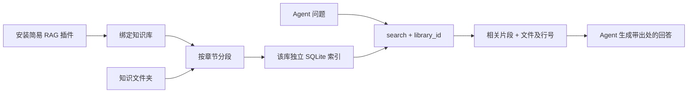

# 简易 RAG 插件

本版打通插件安装、绑定、分段建索引、REST/MCP 检索。插件负责返回证据，调用它的 Agent 负责生成回答。



## 实现与边界

- **切分**：Markdown 按章节切分，TXT 按大小分段，每片段至多 1,200 字符；保留原文、标题、相对文件路径、行号、文件版本及 SHA-256。`document` 模式忽略章节边界，仍受片段长度上限约束。没有重叠窗口，必要时 Agent 用 `read_file` 扩读上下文。
- **检索**：SQLite FTS5 的 BM25 排序；英文标识符按词、中文连续片段按相邻双字分词。多个查询词按 OR 召回，标题匹配加权。参考 [SQLite FTS5 文档](https://www.sqlite.org/fts5.html#the_bm25_function)。
- **范围**：只索引知识库可检索目录；遵守插件 include/exclude 和平台隐藏文件、链接、文件类型限制。默认 Markdown/TXT，排除 drafts/、archive/。
- **隔离**：每库一个索引文件，位于 `KB_STATE_DIR/indexes/<知识库ID的SHA-256>.sqlite3`。Key 只能查询已授权且启用的库，返回前复核授权；索引文件不在知识目录中。
- **一致性**：构建临时 SQLite 后原子替换，失败保留原索引。文件增删改、挂载位置或插件配置变化后，查询返回 `index_stale`，要求手动重建。停用、解除绑定和目录不可用会立即阻止查询。
- **限制**：单库最多 1,000 个文件、16 MiB 原文、16,000 个片段；查询 1–200 字符，返回最多 10 个片段。构建为同步、有界操作。查询会检查全库内容摘要，适合小规模验证，尚未针对百人并发优化。

本版采用词汇检索，不需要 embedding 服务、向量数据库或大模型密钥；同义词、跨语言和隐含语义召回能力有限。没有 reranker 或平台内问答接口，回答由外部 Agent 生成；检索无命中不等于知识必然不存在。

`metadata_fields` 暂不自动抽取业务字段；返回上述固定来源字段。语义/混合模式、自定义索引程序仍只保留声明，不能误报为已可检索。

## 安装与管理台

```bash
python -m folder_kb.plugin_package \
  --source examples/plugins/simple-rag/package \
  --definition examples/plugins/simple-rag/definition.json \
  --output /tmp/simple-rag-plugin
```

1. 管理台 **插件 → 安装插件**，上传产物 `plugin.json` 与 `package.zip`。
2. **知识库 → 插件配置**，绑定 `simple-rag / 1.0.0`，实例配置填 `{}`。
3. **检索索引 → 构建索引**，然后填写问题进行检索测试。文件变化后点击“检查状态”，再重建索引。

一个知识库当前只能绑定一个插件版本。已有更新插件的库如需同时检索，应在原插件新版本的 `plugin.indexing` 中增加 `mode: fulltext` 和内置切分规则，再升级绑定；直接换成 simple-rag 会失去原插件更新能力。

## 接口

| 调用方 | 接口 | 用途 |
|---|---|---|
| 管理员 | `GET /admin/api/libraries/{id}/index` | 索引状态、构建时间、文件和片段数量 |
| 管理员 | `POST /admin/api/libraries/{id}/index/build` | 构建或重建索引 |
| 管理员 | `GET /admin/api/libraries/{id}/search?query=…&limit=5` | 检索测试 |
| Agent Key | `GET /api/v1/search?library_id=…&query=…&limit=5` | 按现有知识库授权检索 |
| MCP | `search(library_id, query, limit=5)` | 同一检索能力和权限检查 |

结果示例：

```json
{
  "library_id": "team-guide",
  "engine": "sqlite-fts5-bm25-v1",
  "content_version": "…",
  "results": [{
    "path": "连接说明.md",
    "start_line": 3,
    "end_line": 5,
    "title": "访问密钥",
    "text": "## 访问密钥\n在管理平台创建专用 Agent Key，按知识库授权。\n",
    "sha256": "…",
    "version": "…",
    "score": 0.12
  }]
}
```

分值仅用于同次查询内排序，不是置信度，不能跨知识库直接比较。Agent 先 `search`，必要时 `read_file` 并带 `expected_version`，再引用文件及行号回答。`search`、`grep` 和 `read_file` 可以共存。`knowledge_info` / `/api/v1/info` 返回该库的索引状态与建议检索流程。

## 与多知识库设计的衔接

已支持同一 Key 在现有授权范围内按 `library_id` 分别调用 search，索引互相隔离。目前还沿用统一读取授权，**尚未实现按 Key、按知识库单独开关 grep/search、动态筛选 tools/list 或组装 instructions**。这些作为下一阶段实现；此版本不会因插件的 instructions 自动改变 Agent 的系统指令。

后续补按库的能力授权，再添加后台增量构建、向量检索适配器；统一的 `search` 和来源引用结构可继续沿用。
