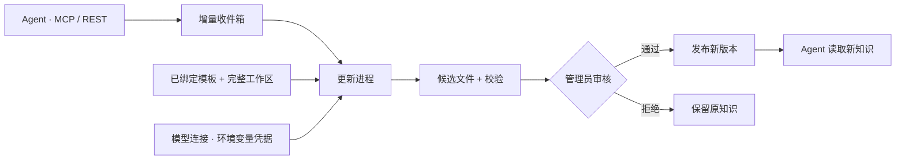

# 模型驱动的知识更新



消费 Agent 的权限不变：读取知识、提交材料、查询自己的回执。只有管理员能配置模型、启用模板程序、审核和发布。提交授权不等于知识写权限。

## 管理台配置

1. **模板**：注册定义并上传 ZIP；核对开发者和程序内容。
2. **知识库 → 模板与工作范围**：绑定模板版本，分别指定完整工作根与检索子目录。
3. **模型连接**：配置 OpenAI 兼容服务地址、模型名、密钥的环境变量名。平台不接收密钥原文。
4. **知识库 → 更新设置**：选择模型连接，填写模板环境变量映射，确认信任当前程序包，启用更新。默认新材料自动触发，每批最多 10 条，候选必须人工审核。
5. 工作区新建模板库并启用更新后，自动初始化并发布初始结构；材料更新仍需审核。平台手动绑定已有目录时，未初始化的库需点击“初始化知识库”并审核候选。详见 [模板库生命周期](library-template-workflow.md)。
6. **更新任务 → 查看**：检查文件差异及各材料处理结论，选择“审核通过并发布”或“拒绝候选”。失败可重试。

以 `folder-kb-memory-template` 为例，绑定 `memory-files / 0.1.0`，实例配置 `{"mode":"llm","default_scope":"personal"}`；工作根设为 `my-memory`，检索子目录设为 `knowledge`。事先创建空的 `my-memory/knowledge` 目录。环境变量映射为：

```json
{
  "MEMORY_LLM_BASE_URL": "base_url",
  "MEMORY_LLM_MODEL": "model",
  "MEMORY_LLM_API_KEY": "api_key"
}
```

平台只传递连接参数，调用模型、解析决策及记忆组织由模板负责。模型服务需支持模板使用的 API；记忆模板使用 Chat Completions 的 JSON object 输出。模型出错时任务失败，不自动替换成假数据。

## Linux 运行

更新进程与 HTTP 服务使用相同 `KB_ROOT`、`KB_STATE_DIR`。HTTP 容器仍只读知识目录；更新进程可写发布目录。只对**审阅过且可信的 Python 模板**开放本版本执行器：它不是第三方代码沙箱。

```bash
# .env 中配置 KB_MODEL_API_KEY，禁止提交真实值。
mkdir -p /srv/knowledge/template-releases
sudo chown 10001:10001 /srv/knowledge/template-releases
docker compose --profile updates up -d --build
```

在模型连接中把密钥环境变量名填为 `FKB_LLM_API_KEY`。Compose 只将这一个凭据传给 template-worker，不传给 knowledge 服务。

直接运行 Python 时：

```bash
export KB_ROOT=/srv/knowledge
export KB_STATE_DIR=/srv/folder-kb-state
export KB_TEMPLATE_TRUSTED_PYTHON=1
export KB_MODEL_KEY_ALLOWLIST=PROVIDER_API_KEY
# 在进程环境中配置 PROVIDER_API_KEY；模型连接的 api_key_env 填同名变量。
python -m folder_kb.template_worker
```

多模型可将各变量名加入 `KB_MODEL_KEY_ALLOWLIST`，以逗号分隔。只有本次任务选择的连接凭据会映射给模板子进程；不继承管理员令牌或其他模型密钥。工作进程须先拥有这些变量，修改凭据后重启工作进程。

## 存储与发布

| 内容 | 位置 |
|---|---|
| 模型连接、更新设置、任务状态、材料关联 | `KB_STATE_DIR/management.sqlite3` |
| 输入快照、标准材料、程序工作区、完整候选及结果 | `KB_STATE_DIR/update-jobs/<job-id>/` |
| 已发布的完整知识工作区 | `KB_ROOT/template-releases/<job-id>/` |
| 模板安装包 | `KB_STATE_DIR/templates/<id>/<version>/package/` |

原始工作根是初始来源。首次发布后，同一工作区的已绑定知识库一起切换到新版本，后续任务基于已发布工作区继续增量处理，逻辑工作区身份保持不变。原目录、旧版本不会被覆盖或自动删除；原目录继续保留用于绑定身份解析。发布后不要再把初始目录当作当前版本编辑。

工作快照排除 `.git`、`.env`、私钥等内容；发布保留源工作区中这些排除文件，避免丢失辅助内容。它们不交给模型。记忆模板的 `metadata/memory-template` 随完整工作区发布，消费 Agent 只挂载 `knowledge`。

生成及发布前会重新检查绑定、模型配置、材料提交权限、程序摘要和基准文件版本。同一工作区只允许一个活动任务；审核期间后续材料排队。失败恢复为待处理，但不会无限自动重试；管理员重试会创建新任务。进程中断后的运行任务标记失败，待审核候选保留。

回执 `update_job` 可区分排队、生成和待审核。只有审核发布完成后回执才出现 `result.published=true`，并记录发布版本；它表示该批处理结果已发布，不代表每条材料都进入检索目录。记忆模板会把观察和不确定信息留在辅助待审区，结论为 `partially_accepted`。

## 管理 API

以下均使用管理员 Bearer Token。

| 方法 | 路径 | 用途 |
|---|---|---|
| GET / PUT | `/admin/api/models` / `/admin/api/models/{id}` | 列出 / 创建或编辑模型连接 |
| GET / PUT | `/admin/api/libraries/{id}/update-policy` | 查询 / 保存更新设置 |
| POST | `/admin/api/libraries/{id}/update-jobs` | `{"operation":"initialize"}` 或 `{"operation":"update"}` |
| GET | `/admin/api/update-jobs?offset=0&limit=50` | 分页任务列表与进程心跳 |
| GET | `/admin/api/update-jobs/{id}` | 任务状态与材料处理结果 |
| GET | `/admin/api/update-jobs/{id}/preview` | 文件差异，超长预览明确标注截断 |
| POST | `/admin/api/update-jobs/{id}/approve` | 审核通过，交给 worker 发布 |
| POST | `/admin/api/update-jobs/{id}/reject` | 拒绝候选，材料回填拒绝结果 |
| POST | `/admin/api/update-jobs/{id}/retry` | 失败后按当前设置重新生成 |

关键状态：`queued → running → candidate_ready → publish_queued → publishing → published`，另有 `failed`、`rejected`。被更新任务接管的材料不能再通过手动领取接口抢占。

## 当前边界

- 本地工作区支持完整生成、审核和发布。Git 关联工作区暂不进入此流程，避免与 Git 同步进程互相覆盖；Git 写回/PR 审核需单独接入。
- 仅执行 `trusted-python-demo`。注册的 `container` 类型目前不会执行；需要运行未知开发者代码时，仍须提供每任务隔离执行器。
- 程序超时会终止子进程；Compose 限制整个 worker 的内存、CPU 和进程数，模板声明的每任务内存/CPU 额度尚未单独执行。
- 单份工作区/候选上限 32 MiB、2000 个条目。候选、旧版本和历史默认保留，尚无自动清理策略。
- 数据库迁移到 v6；HTTP、Git worker、template-worker 一起升级。备份/恢复同时覆盖 SQLite、任务目录和发布目录。

## 可重复验证

```bash
python -m pytest tests/test_updates.py -q
python -m tools.memory_update_demo --template-repo ../folder-kb-memory-template --provider deepseek
```

真实模型演示只使用虚构材料，创建隔离目录并启动本地 HTTP 与独立 worker。验证 MCP 新增、REST 纠错、人工审核门禁、发布后读取、幂等重放、观察待审及辅助文件保留。使用 `--serve` 保留演示管理台（默认 8797），演示令牌固定为 `isolated-memory-demo-admin-only`，仅监听本机；不要用于正式部署。模型请求需要相应环境变量，失败不会静默降级。
